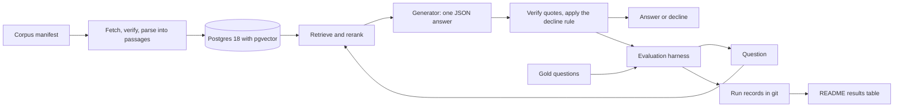

<!-- Author: Nicola Antonello -->

# regulator-graded-rag

`regulator-graded-rag` answers questions about the US hazardous materials regulations,
49 CFR Parts 171–180, with quotes that code verifies word for word, and declines when
its sources do not support an answer. It is graded against answers it did not write: in
its public interpretation letters, the regulator, PHMSA, answers real people's questions
yes or no and cites the sections behind each answer.



Status: phase 1 (foundations) complete. The 2025 edition is fetched by checksum and
split into 13,539 passages, which pass their parse checks. The owner compared 25 sampled
passages with [the printed pages](corpus/parse-review.md): 20 match, and 5 differ only
in that the page sets A₁ and A₂ as subscripts, which
[ADR-0017](docs/adr/0017-passage-text-from-the-xml.md#amendments) keeps as plain text.
Phase 2 (evaluation) is complete: 903 regulator letters are split into dev and
held-out by a committed seed, and BM25 in SQL and the evaluation harness are built. The
dev gold set holds 250 questions, 220 from the letters and 30 written by the owner for
the system to decline; by type, `unanswerable` 36, `table` 43, `multi_passage` 49 and
`lookup` 122. The owner checked every one: code's checks accepted 104 drafts, but the
owner changed 12 of the 40 audited at random, so all 104 went to the owner too
([ADR-0022](docs/adr/0022-code-checks-and-an-audit-for-gold-items.md)). The held-out
split's 120 items are frozen by checksum. BM25 is the first row below; on the 214
answerable dev questions, a paired comparison detects a recall@10 difference of about
6 to 11 points with 80% power, depending on how strongly two setups' scores correlate
([ADR-0020](docs/adr/0020-sample-size-as-a-sensitivity-table.md)). This is not
compliance or legal advice.

## Results

<!-- results:start -->
**Dev, corpus ecaac596…, gold set 7bfdfdf9…, 214 answerable questions**

| Run | Retriever | Settings | Recall@10 | Recall@5 | Recall@20 | Recall@50 | MRR | nDCG@10 | Median seconds |
|---|---|---|---:|---:|---:|---:|---:|---:|---:|
| [2026-11-24-bm25-dev-1](eval/runs/2026-11-24-bm25-dev-1/) | bm25 | b=0.75, config=english, k1=1.2, variant=lucene | 0.691 | 0.610 | 0.761 | 0.856 | 0.575 | 0.558 | 0.050 |
| [2026-11-25-dense-bge-base-dev-1](eval/runs/2026-11-25-dense-bge-base-dev-1/) | dense-bge-base | [dense-bge-base.toml](eval/configs/dense-bge-base.toml) | 0.618 | 0.552 | 0.725 | 0.821 | 0.541 | 0.520 | 0.278 |
| [2026-11-25-dense-gte-modernbert-dev-1](eval/runs/2026-11-25-dense-gte-modernbert-dev-1/) | dense-gte-modernbert | [dense-gte-modernbert.toml](eval/configs/dense-gte-modernbert.toml) | 0.612 | 0.567 | 0.680 | 0.775 | 0.555 | 0.525 | 0.102 |
| [2026-11-26-dense-bge-base-dev-1](eval/runs/2026-11-26-dense-bge-base-dev-1/) | dense-bge-base | [dense-bge-base.toml](eval/configs/dense-bge-base.toml) | 0.618 | 0.552 | 0.725 | 0.821 | 0.541 | 0.520 | 0.103 |
| [2026-11-26-dense-gte-modernbert-dev-1](eval/runs/2026-11-26-dense-gte-modernbert-dev-1/) | dense-gte-modernbert | [dense-gte-modernbert.toml](eval/configs/dense-gte-modernbert.toml) | 0.612 | 0.567 | 0.680 | 0.775 | 0.555 | 0.525 | 0.084 |
| [2026-11-26-dense-qwen3-embedding-dev-1](eval/runs/2026-11-26-dense-qwen3-embedding-dev-1/) | dense-qwen3-embedding | [dense-qwen3-embedding.toml](eval/configs/dense-qwen3-embedding.toml) | 0.626 | 0.534 | 0.727 | 0.791 | 0.528 | 0.511 | 0.095 |
<!-- results:end -->

`uv run python -m regulator_graded_rag.report` writes this table from the committed run
records in `eval/runs/`, and a test fails if it is ever edited by hand.

## How it is evaluated

- **Questions** are yes-or-no questions from the regulator's letters from 2017 on,
  numbered or a letter's only one, kept only when every paragraph they cite reads the
  same in the 2025 edition. Code splits them into dev and held-out before anyone reads
  the letters, and the held-out split runs once.
- **Retrieval** is scored by section recall@10: the share of the sections the regulator
  cited that reach the top 10 passages.
- **Generation** is scored by the supported verdict: the regulator's yes or no, backed by
  at least one quote, verified by code, from a section the regulator cited. Verdict
  accuracy and the false-answer rate sit next to it. It runs closed-book, with the cited
  sections, and end-to-end, so a failure can be traced to a stage.
- **Models:** a local open-weight model answers by default, and Claude Haiku, Sonnet and
  Opus answer the dev questions once as a comparison.

## Quickstart

Needs Python 3.14 with uv; the index and the integration tests also need Docker.

```bash
uv sync --locked
uv run python -m regulator_graded_rag.fetch
uv run python -m regulator_graded_rag.passages
cp .env.example .env
docker compose up -d --wait
uv run --env-file .env python -m regulator_graded_rag.index
uv run pytest tests/unit
```

The build writes the passages to `corpus/parsed/passages.jsonl` and checks that they give
the passage count and corpus version the manifest records. Before starting Postgres,
choose a password in `.env`, the same in both of its lines: Compose reads it, and the
index reads `DATABASE_URL` from it. The index is rebuilt only when the corpus version
changes.

## Read more

- [Design](docs/DESIGN.md): goals, invariants, architecture, evaluation and phases.
- [Decision records](docs/adr/): each decision, with the options it rejected.
- [Further reading](docs/reading/README.md): the sources behind the decisions. Five first
  reads:
  - Chip Huyen, [AI Engineering](https://github.com/chiphuyen/aie-book) (O'Reilly, 2025).
  - Dan Jurafsky and James H. Martin, [Speech and Language Processing, 3rd edition draft](https://web.stanford.edu/~jurafsky/slp3/) (online manuscript, 2026), chapter 11, "Information Retrieval and RAG".
  - Mark Sanderson, [Test Collection Based Evaluation of Information Retrieval Systems](https://doi.org/10.1561/1500000009) (Foundations and Trends in Information Retrieval, 2010).
  - Nelson F. Liu, Tianyi Zhang and Percy Liang, [Evaluating Verifiability in Generative Search Engines](https://doi.org/10.18653/v1/2023.findings-emnlp.467) (Findings of EMNLP, 2023).
  - Cynthia Dwork et al., [The Reusable Holdout: Preserving Validity in Adaptive Data Analysis](https://doi.org/10.1126/science.aaa9375) (Science, 2015).

## License

[Apache License 2.0](LICENSE).
