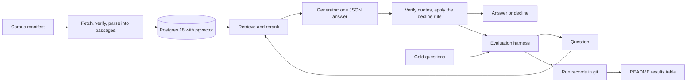

<!-- Author: Nicola Antonello -->

# regulator-graded-rag

`regulator-graded-rag` answers questions about the US hazardous materials regulations,
49 CFR Parts 171–180, with quotes that code verifies word for word, and declines when
its sources do not support an answer. It is graded against answers it did not write: in
its public interpretation letters, the regulator, PHMSA, answers real people's questions
yes or no and cites the sections behind each answer.

Status: phase 1 (foundations) in progress. Nothing runs yet. This is not compliance or
legal advice.

## Results

None yet. The results table is generated from committed run records, never edited by
hand, and its first row will be the BM25 baseline in phase 2.

## How it is evaluated

- **Questions** are numbered yes-or-no questions from the regulator's letters of 2017 to
  2025, kept only when every paragraph they cite reads the same in the 2025 edition.
  Code splits them into dev and held-out before anyone reads the letters, and the
  held-out split runs once.
- **Retrieval** is scored by section recall@10: the share of the sections the regulator
  cited that reach the top 10 passages.
- **Generation** is scored by the supported verdict: the regulator's yes or no, backed by
  at least one quote, verified by code, from a section the regulator cited. Verdict
  accuracy and the false-answer rate sit next to it. It runs closed-book, with the cited
  sections, and end-to-end, so a failure can be traced to a stage.
- **Models:** a local open-weight model answers by default, and Claude Haiku, Sonnet and
  Opus answer the dev questions once as a comparison.

## Read more

- [Design](docs/DESIGN.md): goals, invariants, architecture, evaluation and phases.
- [Decision records](docs/adr/): each decision, with the options it rejected.
- [Further reading](docs/reading/README.md): the sources behind the decisions. Five first
  reads:
  - Chip Huyen, [AI Engineering](https://github.com/chiphuyen/aie-book) (O'Reilly, 2025).
  - Dan Jurafsky and James H. Martin, [Speech and Language Processing, 3rd edition draft](https://web.stanford.edu/~jurafsky/slp3/) (online manuscript, 2026), chapter 11, "Information Retrieval and RAG".
  - Mark Sanderson, [Test Collection Based Evaluation of Information Retrieval Systems](https://doi.org/10.1561/1500000009) (Foundations and Trends in Information Retrieval, 2010).
  - Nelson F. Liu, Tianyi Zhang and Percy Liang, [Evaluating Verifiability in Generative Search Engines](https://doi.org/10.18653/v1/2023.findings-emnlp.467) (Findings of EMNLP, 2023).
  - Cynthia Dwork et al., [The Reusable Holdout: Preserving Validity in Adaptive Data Analysis](https://doi.org/10.1126/science.aaa9375) (Science, 2015).

## License

[Apache License 2.0](LICENSE).
