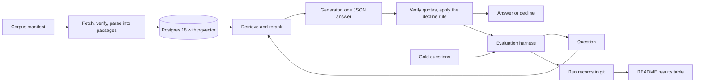

<!-- Author: Nicola Antonello -->

# Design

`regulator-graded-rag` answers questions about the US hazardous materials regulations,
49 CFR Parts 171–180. Each answer gives a verdict, a short explanation and quotes that
code has found word for word in the passages it cites, and the system declines when the
passages it retrieved do not support an answer. It is graded against answers it did not
write. In its public interpretation letters, the regulator, the Pipeline and Hazardous
Materials Safety Administration (PHMSA), answers real people's questions yes or no and
cites the sections behind each answer. This document describes the design as it stands.
The decisions behind it, with the options each one rejected, are in
[`docs/adr/`](adr/).

Status: approved by the owner on 2026-11-08, after approving each section between
2026-11-05 and 2026-11-08. Nothing is built yet.

## Goals

1. Answer a question about the hazmat regulations with a verdict (yes, no or not
   covered), an explanation, and quotes that code has verified in the cited passages.
2. Measure quality against the regulator's own answers, with retrieval and generation
   scored separately, so a failure can be pinned to a stage.
3. Make every published number reproducible from a committed run record, within a total
   budget under $25 for model calls and hosting.
4. Serve two kinds of reading: a 30-second look at the README's results table, and a
   close read of the method, the failures and the decisions.

## Non-goals

- Compliance or legal advice. The demo says so.
- Other rulebooks, such as the international air and sea rules or another country's.
- Multi-turn chat, and fine-tuning models.
- An agent that browses the regulations and follows their cross-references. That is a
  later experiment against this baseline, with its own decision record.
- Breadth for its own sake. A component that moves no measured result does not belong
  here.

## Users

The assumed users are people who ship or inspect hazardous materials and need a rule
quickly, such as shipping staff at small firms and safety trainers. Real users test
that assumption in phase 7. The portfolio audience is AI engineering hiring teams.

## Success criteria

1. One command rebuilds the results table from committed run records.
2. Each retrieval method reports section recall@10 against the BM25 baseline, and counts
   as better only when a paired test supports it. If nothing beats BM25, the report says
   so.
3. Generation reports the supported verdict, with verdict accuracy and the false-answer
   rate next to it, against closed-book and oracle runs.
4. Total spending stays under $25, and every run states its cost.
5. Phases 1 to 4 alone make a complete project that can be shown.

## Invariants

These hold everywhere, and tests check them:

- Every citation resolves: the cited passage exists in this corpus version, and the
  quoted text appears in it word for word. Code checks this after generation; the
  model's word is not evidence.
- The system declines rather than guesses. Unanswerable questions measure this, and the
  false-answer rate is reported next to accuracy.
- Tuning never touches the held-out split. Every held-out run is logged, and the number
  of runs is printed next to its results.
- Every published number can be reproduced from a committed run record: the git commit,
  corpus version, gold-set version, full settings, pinned model IDs, per-question
  outputs and cost.
- Results are compared only on the same corpus and gold-set versions.
- Retrieval and generation are measured separately.
- Every gold label is checked by the owner. Code or a model may draft one, but only the
  owner approves it, and each record says who wrote it.
- Retrieved text is data, never instructions: a passage cannot change the system prompt
  or trigger an action, and a test with planted passages proves it.

## Architecture

The corpus is fetched from a manifest of checksums, parsed into passages and loaded into
Postgres, which holds the passages, the BM25 statistics and the embeddings. A question
is answered by retrieving passages, generating one JSON answer from them and verifying
every quote in code. The harness runs the gold questions through the same path and
saves one run record per run, and the README's table is generated from those records.

### Files and the database

Files are the source of truth, and the database is an index that one command rebuilds
([ADR-0004](adr/0004-postgres-centred-architecture.md)).

| Where | What |
|---|---|
| Git | The corpus manifest, the dev questions, the split assignment (letter numbers only) and its seed, the held-out file's checksum, every run record |
| Local only | The downloaded corpus and letters; the held-out questions, backed up outside the repository; the saved embeddings, whose checksum each run record holds; the API key |
| Postgres | Passages, BM25 statistics and embeddings, labelled with the corpus version and rebuilt from scratch for each one, so there are no migrations |

Postgres 18 with pgvector runs in Docker from the pgvector project's image, pinned by
digest, and runs keyword and vector search as SQL. Python parses, embeds, reranks,
calls the models, verifies quotes and scores.

Three boundaries keep the system testable:

- **One retrieval interface.** Every method takes a question and returns ranked passage
  IDs with scores, so the harness compares methods without knowing how they work.
- **One generator interface.** The local model and Claude implement the same small
  interface. Every call's request and response are saved in the run record, so tests
  replay them without a model, and rescoring costs nothing.
- **No tools for the generator.** A passage cannot trigger an action, and the system
  prompt lives in code.

### Corpus and passages

The corpus is Parts 171–180 of the 2025 annual edition on GovInfo, revised as of
1 October 2025: ten XML files, 9.3 MB and 712,618 words
([ADR-0006](adr/0006-xml-corpus-and-section-passages.md)). The edition stays fixed for
the whole project, and the demo tells users which date its rules are from.

- **Fetching.** A manifest lists each file's URL, size and SHA-256 checksum, and one
  command downloads and checks them. GovInfo answers a missing edition with an HTML page
  and status 200, so the fetch checks the file type and the checksum, never just the
  status.
- **Parsing.** The XML already marks sections, headings, paragraphs and table cells, so
  no PDF parser is needed.
- **Passages.** Paragraphs are merged in reading order up to about 250 words, and a
  passage never crosses a section. A paragraph over the limit is split at sentence ends.
  Each table row is its own passage, carrying its table's column headers. Each passage
  starts with its section number and heading, copied verbatim. The builder gives 13,539
  passages: 10,336 table rows and 3,203 text passages, 31 of them a heading alone
  ([ADR-0017](adr/0017-passage-text-from-the-xml.md)).
- **IDs and versions.** A passage's ID is its section number and its position in the
  section, such as `173.306:4`, and a rebuild gives the same IDs. The corpus version is
  a checksum over every passage's ID and text.

The hard parts are known from counts on the edition:

- §172.101, the Hazardous Materials Table: 82,316 words in 6,386 rows. Across the ten
  parts there are 215 tables with 10,350 rows.
- §172.102, the special provisions: 25,576 words, including one nested block of 14,341
  words that the builder splits at its nested paragraphs.
- §173.435 and §173.436, the A₁ and A₂ values: the exponents are superscripts, so text
  that drops them misreads every value; passages mark them with `^`
  ([ADR-0017](adr/0017-passage-text-from-the-xml.md)).
- 125 images, including the hazard labels from §172.411 on and the package markings in
  §§172.312–172.332, and the 15 in §173.62, which hold its table of packing methods, so
  the packing methods for explosives exist only as images. A text-only system should
  decline a question that needs one.

The parse checks gate phase 1:

- Apart from the heading and column headers that each passage repeats, every word of
  each section's rule text lands in exactly one passage, in order; the amendment
  citations and editorial notes are left out
  ([ADR-0017](adr/0017-passage-text-from-the-xml.md)).
- Every table row with text becomes exactly one passage; the three rows of column
  numbers label the columns instead.
- The owner compares a sample of the hardest passages with the official PDF pages: rows
  of §172.101, §172.102, §173.62 and §173.435.

### Retrieval

**Keyword search is BM25 written in SQL** over Postgres's own tokenizer and stemmer
([ADR-0005](adr/0005-bm25-written-in-sql.md)). Plain tables hold each passage's term
counts and length and each term's document frequency, and one query computes BM25 with
`k1` and `b` as settings. A test compares its scores with the bm25s library on the same
tokens. It runs on the standard pgvector image and on any managed Postgres with
pgvector.

**Phase 3 compares three methods, each against BM25 on dev**
([ADR-0009](adr/0009-local-retrieval-models-and-exact-search.md)):

1. dense retrieval with an embedding model;
2. hybrid retrieval, combining BM25 and dense, with the fusion method (reciprocal rank
   fusion or a convex combination of scores) settled by experiment;
3. a cross-encoder reranker over the top 50 passages from the best first stage.

The models are open-weight, under MIT or Apache-2.0 with no terms to accept, run
locally and are pinned to a Hugging Face revision. They are tried smallest first, and a
bigger one has to earn its place with a measured gain. The candidates:

| Role | Model | Licence | Parameters | Max input (tokens) |
|---|---|---|---|---|
| Embedding | BAAI/bge-base-en-v1.5 | MIT | 109M | 512 |
| Embedding | Alibaba-NLP/gte-modernbert-base | Apache-2.0 | 149M | 8,192 |
| Embedding | Qwen/Qwen3-Embedding-0.6B | Apache-2.0 | 596M | 32,768 |
| Reranker | cross-encoder/ms-marco-MiniLM-L6-v2 | Apache-2.0 | 23M | 512 |
| Reranker | BAAI/bge-reranker-v2-m3 | Apache-2.0 | 568M | 8,192 |
| Reranker | Qwen/Qwen3-Reranker-0.6B | Apache-2.0 | 596M | 40,960 |

- **Exact vector search.** Postgres compares the question with every passage, so a miss
  cannot come from an approximate index. An index such as HNSW comes back only if speed
  demands it, as its own experiment.
- **One machine for published runs.** Graphics cards, Apple chips and plain processors
  round slightly differently, enough to swap two near-tied passages. Passage embeddings
  are computed once on the Windows laptop and saved with a checksum. Other machines load
  that file, and every run record names its machine.

### Generation

**The default generator is a local open-weight model**, under Apache-2.0 or MIT from a
known publisher, run as a 4-bit file pinned by its checksum
([ADR-0011](adr/0011-local-generator-and-json-answers.md)). Phase 4 tries the small
models first, then a larger one:

- Qwen3.5 4B or 9B, or Gemma 4 E4B, entirely on the 8 GB graphics card;
- Qwen3.6-35B-A3B, a mixture-of-experts model, split between the graphics card and RAM
  through Colibri.

The model server (llama.cpp, Ollama or Colibri) is chosen in phase 4.

**Claude is the paid comparison.** Haiku 5.5, Sonnet 5.5 and Opus 5.5 each answer the
dev questions once, through the same interface and in the same format, by the Batch
API. Every run pins the full model ID.

**What the generator receives.** A fixed system prompt kept in code, the question, and
the top passages, each with its ID and section heading, marked as regulation text to
quote and never as instructions. How many passages it gets is a dev experiment.

**What it returns.** One JSON object, enforced by the server's schema or grammar:

| Field | Content |
|---|---|
| `verdict` | `yes`, `no` or `not_covered` |
| `explanation` | A short explanation in plain words |
| `quotes` | A list of `{passage_id, text}` pairs, each text copied from that passage |

**What code does with it, in order**

1. **Read it.** An answer that is not valid JSON in this format is a format failure.
2. **Verify every quote.** The passage must exist in this corpus version, and the text
   must appear in it word for word.
3. **Apply the decline rule.** A yes or no with no verified quote becomes
   `not_covered`. The run record keeps both.
4. **Record refusals apart.** The domain covers explosives, toxic gases and infectious
   substances, which safety filters may react to. A refusal is its own outcome, never a
   decline or an answer, and its rate is reported.

**Repeatability.** The local model always picks the most likely next token, with a
fixed seed, so a run should repeat exactly on the same machine; a repeat run checks
that. The Claude API rejects sampling settings, so its answers can vary between runs.
Every output is stored, so rescoring never needs a new call.

Claude's built-in citations were the first design
([ADR-0010](adr/0010-claude-built-in-citations.md)). Open-weight models lack them, so
they became an experiment when the default generator changed.

## Evaluation

### The gold set

The questions come from PHMSA's interpretation letters dated 2017 to 2025: 871 letters,
read from the Internet Archive's copies because PHMSA's site refuses scripts
([ADR-0007](adr/0007-letter-items-and-drift-check.md)).

- **An item** is one numbered question whose answer starts with yes or no, cites at
  least one section, and needs no picture or attachment. It stores an ID made of the
  letter's reference number and the question number, the letter's date and archive
  address, the question, the regulator's verdict, the cited sections and paragraphs, a
  type, and who wrote and checked it. A fixed rule, not a model, turns "You ask
  whether..." into a direct question.
- **Types**, first match wins: `unanswerable`, `table` (it cites a table section such as
  §172.101), `multi_passage` (it cites several sections) and `lookup`.
- **Rules that changed.** An item is kept only when every paragraph it cites reads the
  same on the letter's date and in the edition, compared by code with eCFR's dated text
  and paragraph IDs. eCFR's dated text starts in 2017, which sets the earliest letter. A
  test checks that eCFR's text for 1 October 2025 matches the GovInfo edition.
- **Measured on a sample of 81 letters.** 34 questions qualified before the drift rule,
  about 0.42 per letter, and about half were answered yes. 19 cited a section that eCFR
  marks as substantively amended since the letter, and in 15 of them a cited paragraph
  really changed. All 15 unflagged questions, the control, compared unchanged. The rule
  keeps about 56%, so roughly 200 questions from the 871 letters, though anything from
  120 to 300 would not be surprising.
- **Unanswerable questions**, about one item in five, measure declining. The owner
  writes them in one private file, about rules clearly outside the corpus, such as the
  international air and sea rules. Letter questions whose answers cite only rules
  outside Parts 171–180 count too, if the full run finds any; the sample found none.
- **Personal data.** Items keep only the question and the answer. A script removes the
  names, emails and phone numbers it recognises, and the owner confirms each item is
  clean.
- **The owner's check.** For each item: the verdict, the cited sections, the date, that
  the question stands on its own, and that no personal data is left.

### Dev and held-out

Code divides the letters before anyone reads them
([ADR-0008](adr/0008-dev-and-held-out-split.md)):

1. A script lists every letter from 2017 on and groups those that belong together:
   near-duplicates, and letters that cite each other's reference numbers.
2. A seed committed in advance sends 40% of each year's groups to held-out and 60% to
   dev. The script prints counts only, and a rerun gives the same split.
3. The three letters opened while the domain was chosen (20-0003, 20-0018 and 20-0034)
   go to dev.
4. The question extractor is built and tested on dev letters only.
5. The owner extracts the held-out questions into a git-ignored folder and checks them
   alone. The same seed splits the owner's unanswerable questions 60/40.
6. Before any tuning, the held-out file's checksum is committed and a backup is made
   outside the repository. Changing the file voids earlier held-out results, and the
   file is published with the final report.

Only the owner reads held-out questions or runs held-out commands. The held-out split
runs once, when the answers stop changing
([ADR-0014](adr/0014-when-the-held-out-split-runs.md)).

**Sizes, estimated.** About 200 letter questions and 50 unanswerable ones make roughly
150 dev and 100 held-out. Retrieval and the supported verdict are scored on the
answerable questions, about 120 in dev and 80 held-out, and the false-answer rate on the
unanswerable ones.

- On held-out, accuracy over about 80 answerable questions has a 95% margin of error of
  about ±11 points.
- On about 120 paired dev questions, a 10-point difference between two setups is
  detected roughly 60% of the time, assuming one question in five changes outcome
  between them. Smaller differences may not be detectable. Phase 2 measures that share
  on dev and redoes the calculation.

### What is measured

Code computes every main number, with no model as judge
([ADR-0012](adr/0012-main-numbers-and-run-records.md)).

**Retrieval** needs no model calls. The gold sections are the sections the regulator
cited, and a cited paragraph counts for its section.

- **Main number:** section recall@10, the share of a question's cited sections found in
  the top 10 passages, averaged over questions.
- **Also reported:** the same share at 5, 20 and 50, plus MRR and nDCG@10.

**Generation runs three ways**, so a failure can be traced to a stage:

| Run | Passages given | What it shows |
|---|---|---|
| Closed-book | None; only the verdict is scored | What the model knows without the regulations, which is also the contamination check |
| Oracle | The passages of the sections the regulator cited | Generation with perfect retrieval |
| End-to-end | The retrieved passages | The whole system |

For a large table section such as §172.101, the oracle run gets the 10 rows closest to
the question by BM25, an approximation of perfect retrieval. The gap between oracle and
end-to-end is what retrieval costs, and the gap between closed-book and oracle is what
reading the rules adds.

- **Main number:** the supported verdict. The yes or no matches the regulator's, and at
  least one verified quote comes from a section the regulator cited.
- **Next to it, always:** verdict accuracy, and the false-answer rate, which counts a
  yes or no given where the system should have declined.
- **Also reported, by question type:** the decline rate on answerable questions,
  citation precision and recall, quote failures, format failures and refusals, cost and
  speed (dollars for Claude, time for the local model).

The regulator does not cite every relevant section, so a correct answer that quotes
another valid section scores as unsupported. Verdict accuracy next to the main number
shows how often that happens.

**Contamination is measured, not avoided.** Most letters predate any current model's
training cutoff. The closed-book run shows what the model answers from memory, and
results are also reported for letters dated after the model's training cutoff, where
the model states one.

**Comparisons.** An experiment states its hypothesis first, changes one stage, and is
judged by that stage's main number with everything else fixed. The test is a paired
randomization test on per-question scores, with a 95% interval for the difference. The
number of configurations tried is recorded, and a lost experiment stays in the table. A
model used as a judge, if one is ever needed, is first measured against labels the
owner wrote.

### Run records

Every run writes one committed folder:

- **The run file:** the git commit and whether the tree had uncommitted changes, the
  corpus version, the gold-set checksum, the split, the full settings, model IDs or file
  checksums, the prompt version, the machine, token counts, cost and the running total,
  and for a held-out run, how many there have been.
- **Per question:** the top 50 passage IDs with scores, the raw output, the parsed
  verdict and quotes, each quote's check, the final verdict, time and tokens. Records
  hold IDs, never passage or letter text.
- **Resumable:** each question is saved as it finishes, so a stopped run picks up where
  it left off.

One command builds the README's results table from the run records, and the table is
never edited by hand.

### Budget

The whole project spends under $25 on model calls and hosting. Evaluation runs use the
Batch API at half price. At the 2026-11-06 prices, one 150-question dev run costs about
$0.07 on Haiku 5.5, $1.35 on Sonnet 5.5 and $2.70 on Opus 5.5, so the comparison costs
about $4.12. These figures assume 4,000 input and 1,000 output tokens per question,
which a five-question pilot measures first. Every paid run states its estimate from the
live price page and the running total, stops at a hard cap, and needs the owner's
go-ahead. Spent so far: $0.

## Code, tests and CI

The repository, CI and security rules are in
[ADR-0013](adr/0013-repository-ci-and-security.md).

- **Code.** One Python package with one command per step: fetch, build passages, index,
  split the letters, extract questions, run, score and report. Each long step shows a
  counter, the elapsed time and what is left, and resumes after an interruption.
- **Tests.** Unit tests need no database or network. Integration tests run against a
  real Postgres in Docker, not mocks. They cover:
  - the passage builder: word conservation, one passage per table row, stable IDs;
  - BM25 in SQL against bm25s on a small sample corpus;
  - the quote check, the decline rule, JSON parsing, the metrics and the statistical
    test, against hand-worked examples;
  - the split: the same seed gives the same split, and near-duplicates stay together;
  - prompt injection: a planted passage must not change the answer. CI replays recorded
    answers, and dev runs use the live local model.
- **Evidence that a check works.** Every new test is seen failing first. Deliberate
  breakages prove each check: a broken quote is rejected, a changed BM25 formula fails
  the comparison, a dropped word fails conservation. Every check that finds nothing has
  a control that finds something.
- **CI.** GitHub Actions run on every pull request and every push to `main`, with no
  path filters. A checks job runs gitleaks, actionlint, zizmor, ruff and mypy, plus a
  check that rejects any commit-message trailer other than `Refs:`. The Python tools
  come from uv's lock, gitleaks and actionlint from their official images pinned by
  digest, and one script runs the gates in order on every machine and in CI
  ([ADR-0015](adr/0015-phase-1-tooling.md)). A tests job runs with the pgvector image
  pinned by digest. CI holds no model API keys,
  calls no paid API and downloads no models, because it replays recorded outputs.
  Actions are pinned to full commit SHAs, the token is read-only, and dependency updates
  arrive weekly after a 7-day cooldown that security updates skip.
- **Repository.** `regulator-graded-rag`, public, under Apache-2.0. A ruleset protects
  `main`: pull requests only, required checks, linear history and rebase merges, with
  merged branches deleted. Only the first commits went straight to `main`, before the
  ruleset existed ([ADR-0013](adr/0013-repository-ci-and-security.md)). Commits name
  the owner's GitHub no-reply address, never a personal one
  ([ADR-0016](adr/0016-commits-use-github-no-reply-email.md)).

## Security

- The Anthropic API key lives only in a git-ignored file on the Windows laptop. CI has
  none, and the demo's key has a spending limit and a budget alarm.
- Model weights load only from safetensors or GGUF files that match their pinned
  checksum: never pickle-based files, which can run code when loaded, and never models
  that need code from their own repository.
- Local model servers listen only on localhost.
- The corpus is pinned by checksums, so a changed file fails the fetch.
- Raw letters are never committed. Items are cleaned, and the owner checks each one.
- uv's lock file pins every dependency by hash.
- Only public corpus text and the project's own questions go to a model provider.

## Phases and exit checks

Each phase gets its own implementation plan when it starts. The times are rough
full-time estimates, none of them measured.

| Phase | What gets built | Exit check | Rough time |
|---|---|---|---|
| 1. Foundations | The repository, CI, Postgres in Docker, the corpus fetch, the passage builder, the trailer check | Word conservation, one passage per table row and stable IDs pass; the hardest sections pass their checks and the owner's comparison with the PDF pages; CI is green on `main` | 1 week |
| 2. Evaluation first | The letters fetched, grouped and split; questions extracted and drift-checked; the owner's check and unanswerable questions; the harness; BM25 in SQL | The owner has approved the dev questions; the held-out file is frozen with its checksum committed; BM25's results row comes from a committed run record | 1.5 weeks |
| 3. Retrieval | Dense retrieval, hybrid retrieval and reranking | Each has an experiment record with a verdict, losses included | 1 week |
| 4. Generation | The local generator with the JSON format, quote check, declines and refusals; closed-book, oracle and end-to-end runs; the injection test; the Claude comparison | The generation table shows the supported verdict, verdict accuracy and the false-answer rate; the owner decides when the held-out split runs | 1–1.5 weeks |
| 5. Improvements | Chunking by regulation paragraph, contextual enrichment, query rewriting and table handling, each with cost and latency | Each has an experiment record against the current best, losses included | 1 week |
| 6. Production | An API and a minimal UI, tracing, per-query cost and latency, guardrails, the hosted demo | The demo is live behind a spending limit and a budget alarm, and each deploy had the owner's go-ahead | 1 week |
| 7. Evidence | The held-out run if it has not happened yet, the failure analysis by stage, feedback from real users, a 2-minute video | The report holds the held-out results and the failure analysis, and the video is linked | 1 week |

Phases 1 to 4 take about 4–5 weeks and alone make a complete project. A phase starts
only when the previous one passes its exit check. Every change to retrieval or
generation lands with its experiment record, in any phase.

## Decisions still open

Each is made when its phase starts, with options and an ADR:

- **Phase 2:** how near-duplicate letters are detected, the review tool for the owner's
  check, and the sample-size calculation, redone on dev.
- **Phase 3:** the embedding and reranking models, the fusion method and the reranking
  depth, all settled by experiment.
- **Phase 4:** the generator model and its server, the number of passages in the
  prompt, the prompt itself, and the thinking setting for Claude.
- **End of phase 4:** whether the held-out split runs then or after phase 5.
- **Phase 5:** which improvements to try, chosen from the dev failure analysis.
- **Phase 6:** where the demo is hosted and which model serves it, the guardrails, and
  the tracing tool.

## Risks to check first

| Risk | Checked in | If it fails |
|---|---|---|
| Too few questions to tell setups apart: the sample predicts about 200, with about 120 answerable in dev | Phase 2, right after the split | Every comparison shows its interval, and "no difference" reads as "too small to see". A large shortfall brings the 2017 cut-off back to the owner |
| The local model cannot copy quotes word for word, or is too slow. A schema fixes the JSON's shape, not the wording of a quote | Phase 4, by the oracle run | An unverified quote is already a decline, so the cost shows as a measured decline rate, never as a false citation. Next comes a larger model through Colibri, whose README gives about 11 tokens a second on 8 GB cards, roughly 4 hours per dev run; or Haiku as the default, about $0.07 per dev run, which reopens ADR-0011 with the owner |
| Sources refuse scripts: PHMSA returns 403, the Internet Archive returned 503 during design, and eCFR needed a specific request header | Phases 1 and 2 | Each file is fetched once, with retries and backoff, and kept with its checksum. All work runs from the saved copies |
| The owner's checking time is on the critical path: the held-out file must be frozen before phase 3, and only the owner checks it | Phase 2 | The harness and BM25 are built meanwhile. At one to two minutes per question, checking takes roughly 4–8 hours, plus 1–2 hours to write the unanswerable questions; up to two working days if the letters take longer |
| eCFR's text for 1 October 2025 differs from the GovInfo edition | Phase 2, by its test | The mismatch goes to the owner before any item depends on it |
| Hazmat questions trigger safety refusals | Phase 4 | Refusals are their own outcome, reported and never counted as declines |
| A newer edition appears | Any phase | The project stays on 2025. Moving would mean a new corpus version and every run redone |
| The hosted demo: serving the local model publicly is the one cost not yet priced | Phase 6 | Retrieval on a small CPU host with managed Postgres (BM25 in SQL needs no extension, and Neon and Supabase listed pgvector on 2026-11-05), with Haiku under a hard spending cap; or the local model shown only in the video |

## Decision records

- [ADR-0001: Record decisions as ADRs](adr/0001-record-decisions-as-adrs.md)
- [ADR-0002: Python for the project](adr/0002-python.md)
- [ADR-0003: US hazmat rules as the domain, graded by the regulator's letters](adr/0003-hazmat-rules-and-phmsa-letters.md)
- [ADR-0004: A Postgres-centred architecture](adr/0004-postgres-centred-architecture.md)
- [ADR-0005: BM25 written in SQL](adr/0005-bm25-written-in-sql.md)
- [ADR-0006: The 2025 XML edition, split into section passages](adr/0006-xml-corpus-and-section-passages.md)
- [ADR-0007: Test items from the letters, kept only where the rules did not change](adr/0007-letter-items-and-drift-check.md)
- [ADR-0008: Dev and held-out, split by letter in code](adr/0008-dev-and-held-out-split.md)
- [ADR-0009: Local retrieval models and exact vector search](adr/0009-local-retrieval-models-and-exact-search.md)
- [ADR-0010: Claude's built-in citations for answers](adr/0010-claude-built-in-citations.md) (superseded by ADR-0011)
- [ADR-0011: A local open-weight generator with one JSON answer format](adr/0011-local-generator-and-json-answers.md)
- [ADR-0012: The main numbers and run records](adr/0012-main-numbers-and-run-records.md)
- [ADR-0013: The repository, CI and security](adr/0013-repository-ci-and-security.md)
- [ADR-0014: When the held-out split runs](adr/0014-when-the-held-out-split-runs.md)
- [ADR-0015: Phase 1 tooling: Python 3.14, mypy and pinned gate tools](adr/0015-phase-1-tooling.md)
- [ADR-0016: Commits use GitHub's no-reply email](adr/0016-commits-use-github-no-reply-email.md)
- [ADR-0017: Passage text from the XML](adr/0017-passage-text-from-the-xml.md)
